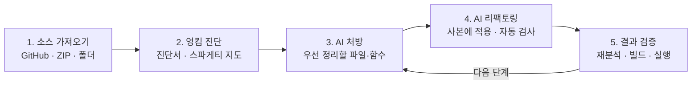

# G-SI 게임 코드 스파게티 분석기

> 게임 소스 코드에서 구조가 복잡하게 얽힌 부분(스파게티 코드)을 찾아 점수로 제시하고, AI를 활용해 단계적으로 리팩토링한 뒤 빌드와 실행으로 검증하는 도구입니다.


성균관대학교 소프트웨어학과 졸업작품(개인, 2026)입니다.

---

## 개요

- **측정:** 게임 코드의 구조를 다섯 가지 지표로 측정하고 **G-SI(Game Spaghetti Index)** 점수로 종합합니다. 점수가 높은 파일이 우선 검토 대상입니다.
- **사용 방식:** 로컬 웹 프로그램에 GitHub 주소나 ZIP·폴더를 입력하면 진단서와 스파게티 지도를 제공합니다.
- **AI 활용:** AI가 우선 정리할 파일과 함수를 처방하고, 큰 함수를 분리하는 변경안을 작성합니다. 변경은 원본이 아닌 사본에만 적용하며, 프로그램이 다시 분석해 수치로 확인합니다.
- **검증 범위:** OpenRA(C#), Chocolate Doom(C), OpenRCT2(C++)에서 점수와 과거 버그 수정 이력의 관계를 확인했습니다. OpenTyrian(C)에서는 AI 리팩토링, 빌드, 실제 실행까지 확인했습니다.

## 사용 흐름



| 단계 | 내용 |
|---|---|
| 소스 가져오기 | 공개 GitHub 주소를 입력하거나 ZIP·폴더를 선택합니다. 분석할 폴더와 언어를 지정합니다. |
| 엉킴 진단 | 파일별 점수와 근거, 복잡한 함수, 연결된 파일을 제시합니다. 스파게티 지도에서 파일 간 연결을 확대·강조해 확인합니다. |
| AI 처방 | AI가 구조 요약을 바탕으로 우선 정리할 파일(최대 5개)과 방법을 제안합니다. 순환 의존 등의 수치는 프로그램이 계산합니다. |
| AI 리팩토링 | 파일별 변경안을 작성하고, 검사 규칙(원본 보존, 함수 정의 확인 등)을 통과한 변경만 사본에 적용합니다. |
| 결과 검증 | 수정한 함수의 복잡도 변화, 코드 전후 비교, 엉킴 총량(초기값 100)을 제시합니다. 시연 게임은 빌드 후 실행 결과를 기록합니다. |

자세한 내용은 [로컬 웹 사용 안내](docs/local-web-guide.md)와 [AI 처방·리팩토링·검증 안내](docs/ai-refactoring-guide.md)에 있습니다.

## 핵심 결과

### 1. 점수와 과거 버그 수정 이력의 관계

4개 주요 사례 모두에서 G-SI 점수와 파일별 버그 수정 횟수 사이에 양의 상관이 나왔습니다(파일 단위 Spearman ρ, 모두 p < 10⁻⁶).

| 사례 | 언어 | 규모 | G-SI ρ | LOC ρ | CC ρ |
|---|---|---|---:|---:|---:|
| [OpenRA.Game](reports/openra-game/index.html) | C# | 3.2만 줄 | **+0.605** | +0.699 | +0.552 |
| [OpenRA.Mods.Common](reports/openra-mods-common/index.html) | C# | 11.7만 줄 | **+0.535** | +0.613 | +0.527 |
| [Chocolate Doom](reports/chocolate-doom/index.html) | C | 19만 줄 | **+0.601** | +0.682 | +0.503 |
| [OpenRCT2](reports/openrct2/index.html) | C++ | 48.6만 줄 | **+0.463** | +0.542 | +0.312 |

- G-SI는 4개 사례 모두에서 복잡도(CC) 단독보다 상관이 높고, 코드 길이(LOC) 단독보다는 낮습니다.
- 코드 길이의 영향을 뺀 부분 상관도 4개 사례 모두 양수(0.12~0.19)입니다. 코드 길이만으로 설명되지 않는 구조 정보가 있음을 의미합니다.
- G-SI는 CC와 다른 파일을 점검 후보로 제시하기도 합니다(예: Chocolate Doom `i_system.c`).
- 이 결과는 과거 이력과의 관련성이며, 미래 결함 예측을 증명하지는 않습니다.

### 2. AI 단계적 리팩토링 (OpenTyrian)

- AI가 큰 함수를 보조 함수로 분리하고, 프로그램이 검사, 재분석, 빌드, 실행을 차례로 확인했습니다.
- 실제 2단계 리팩토링에서 6개 파일이 모두 검사를 통과했고, 엉킴 총량은 100 → 98.55 → 97.05로 줄었습니다.
- 4개 게임·3개 언어의 17개 파일 시험(Codex Sol 모델)에서 첫 변경안 16개가 검사를 통과했습니다.
- 검사를 통과한 변경이 빌드에 실패하는 사례를 발견해 수정했으며, 이에 따라 마지막 단계에 빌드 검증을 두었습니다.

<details>
<summary><b>G-SI 지표 설명</b></summary>

| 지표 | 측정 내용 |
|---|---|
| CC (순환 복잡도) | 함수 내부 분기의 수 |
| Coupling (결합도) | 다른 파일과의 연결 정도 |
| DependencyCycle (순환 의존) | 상호 참조 고리에 포함되는지 여부 |
| GlobalState (전역 상태) | 전역 변수 사용 정도 |
| GameLoopCentrality (게임 루프 중심성) | 게임 루프와의 호출 거리 |

- 다섯 지표에 가중치를 적용해 합산한 뒤, 분석 대상 프로젝트 내 백분위(0~100)로 나타냅니다.
- G-SI는 검토 후보를 고르는 도구이며, 코드 품질이나 결함 확률을 판정하지 않습니다.
- 전역 상태와 게임 루프 연결은 정적 분석으로 추정한 값입니다.
- 공식과 가중치는 [G-SI 공식](docs/si-formula.md)에 있습니다.

</details>

## 빠른 시작

### 요구 사항

- Python 3.10 이상
- .NET 8 SDK (C# 분석에 필요)
- (선택) AI 기능: Claude Code 또는 Codex 로그인, 또는 OpenAI 호환 API 키

### 설치

```bash
py -3.10 -m pip install -e ".[web]"
cd csharp-analyzer && dotnet build && cd ..
```

### 웹 프로그램 실행

```bash
py -3.10 -m game_si.web
```

브라우저에서 `http://127.0.0.1:8765`를 엽니다. 로컬 PC에서만 접속할 수 있는 서버입니다.

<details>
<summary><b>명령줄(CLI) 사용법</b></summary>

```bash
# 정적 분석 → scoring.json과 HTML 대시보드
py -3.10 -m game_si analyze <소스 폴더> --lang {csharp,c,cpp,auto} --out reports/<이름>

# 버그 수정 이력과의 상관 측정
py -3.10 -m game_si validate <git 저장소> --scoring reports/<이름>/scoring.json --subdir <하위 폴더>

# 외부 도구(Lizard)와 비교
py -3.10 -m game_si compare <소스 폴더> --scoring reports/<이름>/scoring.json

# 과거 여러 시점의 점수 변화
py -3.10 -m game_si timeseries <git 저장소> --lang c --subdir src --samples 12 --out reports/<이름>
```

- 이 밖에 `diff`, `tune`, `ablate`, `score-full`, `advise` 명령이 있습니다. 전체 목록은 `py -3.10 -m game_si --help`로 확인합니다.
- C/C++는 기본 분석(tree-sitter)과 정밀 분석(`--cpp-backend clang`, `compile_commands.json` 필요)을 고를 수 있습니다. 자세한 내용은 [컴파일 설정 기반 분석 안내](docs/compiler-aware-cpp.md)에 있습니다.
- 종료 코드는 정상 `0`, 부분 분석 `3`, 실패 `1`입니다.

</details>

### 테스트

```bash
py -3.10 -m pytest tests -q
```

## 결과 자료

| 항목 | 위치 |
|---|---|
| 전체 결과 대시보드 | [reports/index.html](reports/index.html) |
| 사례별 대시보드 | [OpenRA.Game](reports/openra-game/index.html) · [OpenRA.Mods.Common](reports/openra-mods-common/index.html) · [Chocolate Doom](reports/chocolate-doom/index.html) · [OpenRCT2](reports/openrct2/index.html) |
| 측정 결과 종합 | [docs/benchmark-manifest.md](docs/benchmark-manifest.md) |
| 최신 재검수 결과 | [docs/refinement-review.md](docs/refinement-review.md) |

HTML 대시보드는 외부 라이브러리 없이 단일 파일로 구성되어 있어, 내려받은 뒤 브라우저에서 바로 열 수 있습니다.

## 저장소 구성

```text
game_si/            Python 메인 패키지 (분석 · 점수 · 웹 · AI 연동)
  └── web/          로컬 웹 프로그램
csharp-analyzer/    C# 분석기 (.NET 8, Roslyn)
tests/              자동 테스트
reports/            고정 실험 결과 (대시보드 · JSON)
docs/               설계 · 검증 · 사용 안내 문서
.github/workflows/  G-SI 품질 게이트 예시
```

## 문서

| 문서 | 내용 |
|---|---|
| [로컬 웹 사용 안내](docs/local-web-guide.md) | 실행 방법, 입력 방법, 준비 조건 |
| [AI 처방·리팩토링·검증 안내](docs/ai-refactoring-guide.md) | AI 연결 방법, 변경안 검사 규칙, 엉킴 총량 |
| [G-SI 공식](docs/si-formula.md) | 지표, 가중치, 등급 |
| [측정 결과 종합](docs/benchmark-manifest.md) | 분석 대상과 사례별 측정 결과 |
| [C/C++ 정밀 분석](docs/compiler-aware-cpp.md) | Clang 분석의 준비 조건과 한계 |
| [AST 스키마](docs/ast-schema.md) | 분석기가 만드는 데이터 형식 |
| [문서 전체 목록](docs/README.md) | docs 폴더 안내 |

## 한계

- G-SI는 정적 분석입니다. 이벤트·리플렉션 같은 동적 호출과 매크로가 많은 코드는 완전히 해석하지 못합니다.
- 매크로가 많은 C/C++ 파일은 일부 줄을 건너뛰고 '부분 분석'으로 표시합니다.
- 버그 수정 커밋은 메시지로 찾기 때문에 실제 원인 코드와 완벽히 일치하지는 않습니다.
- AI 리팩토링은 자동 검사·빌드·실행으로 확인하지만, 게임 전체의 동작이나 버그 제거를 보장하지 않습니다.
- 사례 프로젝트가 3개이므로 가중치 조정 효과의 통계적 유의성은 검정하지 않았습니다.

## 출처와 라이선스

- 분석 대상 게임(OpenRA, Chocolate Doom, OpenRCT2, OpenTyrian, DOOM 3)의 원본 소스는 이 저장소에 포함하지 않았습니다. 고정 실험은 [측정 결과 종합](docs/benchmark-manifest.md)에 기록한 커밋으로 재현할 수 있습니다.
- AI 기능은 프로젝트 전체가 아니라 구조 요약과 선택한 파일만 AI 서비스로 보냅니다. 보내는 범위는 화면에 표시합니다.

## 프로젝트 정보

| 항목 | 내용 |
|---|---|
| 소속 | 성균관대학교 소프트웨어학과 |
| 유형 | 졸업작품 (개인) |
| 분야 | 보안 / SW 공학 |
| 상태 | 최종 제출 완료 (2026년 10월 30일) |
